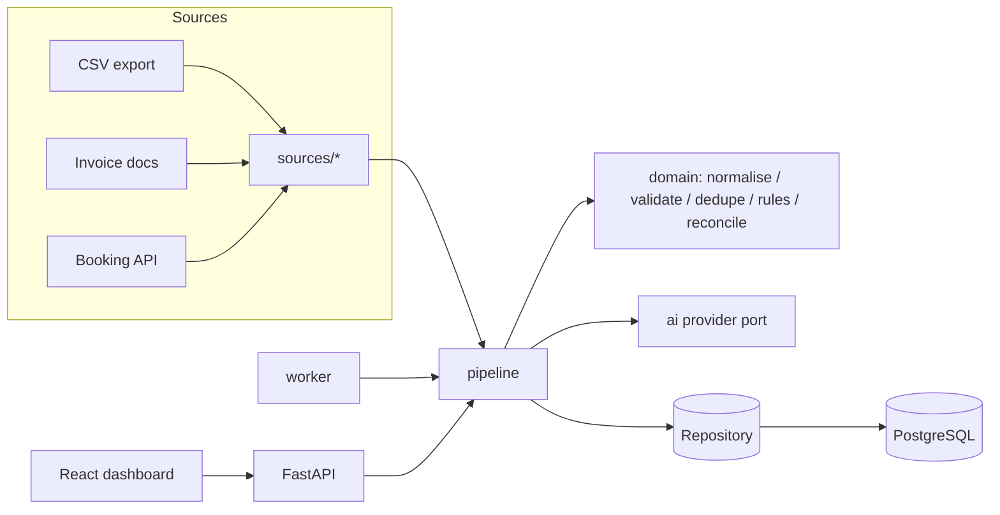

# OpsFlow — Architecture

OpsFlow turns messy, manual back-office data handling into a reliable, observable,
auditable workflow. The reference customer is **Kestrel Freight Co.**, a fictional
small logistics company. Every company, vendor, record and rule in this repository
is invented.

## 1. Problem statement

Kestrel receives operational money data from three channels:

| Channel | Shape | Example content |
|---|---|---|
| Bank/card export | CSV file per business day, with a control trailer | fuel, tolls, repairs, customer receipts |
| Vendor invoices | PDF-style text documents, one per invoice | line items + stated total |
| Booking portal API | Paginated JSON records | customer bookings (revenue) |

Today someone copies these into spreadsheets, guesses categories, and nobody can
prove that every record was counted exactly once. OpsFlow must:

1. accept each delivery exactly once (idempotent ingestion);
2. keep the raw input immutable and traceable;
3. normalise and validate every record, recording *why* a record failed;
4. categorise with deterministic rules first, optionally an LLM second;
5. route anything uncertain to a human instead of guessing;
6. prove, per delivery, that `received = processed + excluded + pending`;
7. survive crashes, outages and reruns without double counting;
8. show all of this on an operations dashboard with a full audit trail.

### Non-goals (v1)

- Multi-tenant SaaS, authentication beyond a single operator identity header.
- Multi-currency accounting (non-USD records are rejected explicitly).
- Cross-source matching (e.g. invoice ↔ bank payment). See §7, *double counting*.
- Real OCR. "PDF-style" documents are structured text; the parser port allows a
  real extractor later.

## 2. Architectural style

A **modular monolith** with a **ports-and-adapters** core:

```
                   ┌──────────────────────────────────────────┐
  CSV / invoice ──▶│ sources/  (adapters: parse bytes → raw)   │
  booking API  ──▶ │                                           │
                   └───────────────┬──────────────────────────┘
                                   ▼
┌───────────┐   ┌──────────────────────────────────────────────┐   ┌────────────┐
│ api/      │──▶│ pipeline/  orchestration (batch + record      │──▶│ ai/        │
│ FastAPI   │   │            state machines, retries, leases)   │   │ provider   │
└───────────┘   │ domain/    PURE logic: normalise, validate,   │   │ port: mock │
┌───────────┐   │            dedupe, rules, reconcile, states   │   │ / OpenAI / │
│ worker    │──▶│                                              │   │ Anthropic /│
│ (poller)  │   └───────────────┬──────────────────────────────┘   │ Gemini     │
└───────────┘                   ▼                                   └────────────┘
                   ┌──────────────────────────────────────────┐
                   │ storage/  Repository port                 │
                   │   ├─ memory  (unit tests, demo)           │
                   │   └─ postgres (system of record)          │
                   └──────────────────────────────────────────┘
┌───────────┐
│ web/      │  React dashboard → api/ only (never talks to the DB)
└───────────┘
```



**Why a monolith:** one deployable, one database, one transaction boundary. A
small business cannot operate Kafka. Module boundaries are enforced by imports
(`domain/` imports nothing from `storage/`, `api/`, or `ai/` adapters).

## 3. Components

| Module | Responsibility | Depends on |
|---|---|---|
| `domain/` | Pure functions & value objects: states and legal transitions, money parsing, normalisation, validation, duplicate fingerprints, rule engine, reconciliation maths. No I/O. | stdlib only |
| `sources/` | Turn delivered bytes into `RawRecord`s + optional control totals. One adapter per channel. | `domain` |
| `ai/` | `ClassificationProvider` port; `MockProvider` (deterministic, fault-injectable); real providers added later. Strict structured-output parsing. | `domain` |
| `storage/` | `Repository` port + adapters. Owns transactions. Postgres adapter enforces invariants with constraints. | `domain` |
| `pipeline/` | Ingest, process (batch lease → file validation → record steps), retries, review resolution, reconciliation trigger. Writes audit events in the same transaction as state changes. | all of the above (via ports) |
| `synth/` | Seeded synthetic data generator + scenario manifest (ground truth for tests). | `domain` |
| `api/` | HTTP surface: upload, batch/record queries, review queue, rerun, audit. | `pipeline`, `storage` |
| `worker` | Polls for `RECEIVED` / due `RETRY_PENDING` batches and processes them. | `pipeline` |
| `web/` | Operations dashboard. | `api` |

## 4. Processing flow

```
ingest(bytes) ── sha256 already known? ──yes──▶ return existing batch (audit: DUPLICATE_SUBMISSION)
     │no
     ▼
Batch RECEIVED
     │ worker leases batch (compare-and-set status)
     ▼
Batch VALIDATING ── file structure invalid ──▶ VALIDATION_FAILED (terminal; resubmit a fixed file)
     │ raw records persisted (idempotent on batch_id+line_no)
     ▼
Batch PROCESSING ── for each raw record not yet terminal:
     │   step A (tx): normalise → validate → duplicate check
     │        → VALIDATION_FAILED | DUPLICATE | VALIDATED
     │   step B (tx): classify (rules → AI?) 
     │        → PROCESSED | NEEDS_REVIEW (+ review task)
     │   transient error (AI/API outage) ─▶ batch RETRY_PENDING (backoff) / FAILED (exhausted)
     │   unexpected error ───────────────▶ batch FAILED (committed work kept; rerun resumes)
     ▼
Batch PROCESSED ─▶ reconcile (derived aggregates) ─▶ reconciliation_status
                                       RECONCILED | MISMATCH | PENDING | UNKNOWN
review decision ─▶ record PROCESSED | REJECTED ─▶ re-reconcile batch
```

## 5. Key decisions

| # | Decision | Reason | Trade-off |
|---|---|---|---|
| D1 | PostgreSQL is both system of record **and** work queue (`UPDATE … WHERE status IN (…) RETURNING`, `FOR UPDATE SKIP LOCKED`). | One moving part; transactional state + audit. | Not for very high throughput — fine for SME volumes. |
| D2 | **Deterministic IDs** (UUIDv5): batch = f(source_type, content sha256); raw record = f(batch_id, line_no). | Replays produce identical IDs; IDs are immutable and never reassigned. | IDs reveal nothing secret, but are predictable — acceptable internally. |
| D3 | Money is **integer minor units** (`BIGINT` cents) + explicit `direction` (DEBIT/CREDIT). Amount is always > 0. | No float error; sign never carries hidden meaning. | Parsing must be strict. |
| D4 | **Two separate state dimensions** on a batch: `status` (execution) and `reconciliation_status` (correctness). | A batch can be fully executed and still not balance; one field cannot mean both. | Dashboard shows two badges. |
| D5 | Reconciliation is **always recomputed from current record states** by aggregate query, never from incremented counters. | Reruns and review decisions cannot double count. | Slightly more SQL per reconcile — trivial at this scale. |
| D6 | Each record is processed in **two short transactions** (validate, classify). | A crash or AI outage between them leaves an explicit `VALIDATED` state that resumes cleanly. | More commits; fine. |
| D7 | **Rules first, AI second, human last.** Rule decisions store no confidence; AI decisions store confidence + rationale in a separate `classification_attempt` table. | Explainability; AI never overwrites evidence silently. | Extra table. |
| D8 | AI responses are cached by (input fingerprint, provider, model, prompt version). | Deterministic replay and no double spend on reruns. | Cache invalidation is by version bump. |
| D9 | Audit events are **append-only** and written in the **same transaction** as the change they describe. | The trail can never disagree with the data. | Postgres trigger blocks UPDATE/DELETE on `audit_event`. |
| D10 | Time comes from an injected `Clock`. | Deterministic tests for backoff, lateness, ordering. | One extra parameter. |
| D11 | Unknown is a first-class outcome (`UNKNOWN`, `PENDING`, `NEEDS_REVIEW`). | Never convert "can't tell" into success. | Users see more amber — that is the point. |

## 6. Deployment (target)

`docker compose up` → `postgres`, `api` (uvicorn), `worker`, `web`. Configuration
via environment variables; `.env.example` documents them. AI is `mock` by default;
real providers require an API key in the environment and are never required.

## 7. Cross-cutting concerns

- **Idempotency:** content hash on delivery, `(batch_id, line_no)` on raw rows,
  natural key `(source_type, source_ref)` for business duplicates, cached AI calls,
  compare-and-set state transitions.
- **Double counting:** duplicates are excluded from processed totals; each delivery
  reconciles only against its own control totals; sources are **not** summed
  together because an invoice and the bank payment of that invoice describe the
  same economic event (cross-source matching is v2).
- **Observability:** JSON logs with `batch_id`, `run_id`, `record_id`; every batch
  attempt is a `processing_run` row with outcome and error.
- **Security:** synthetic data only; secrets only via environment; no secrets in
  logs; operator identity recorded on every human action.
