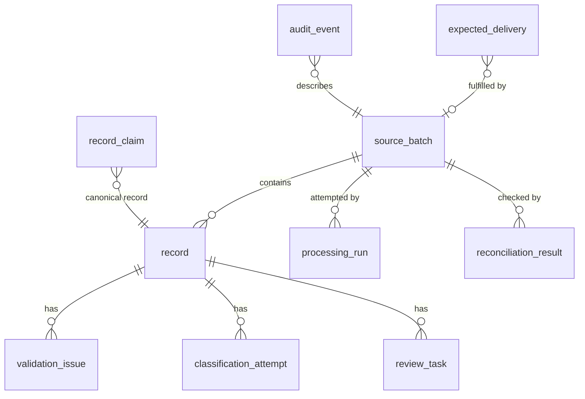
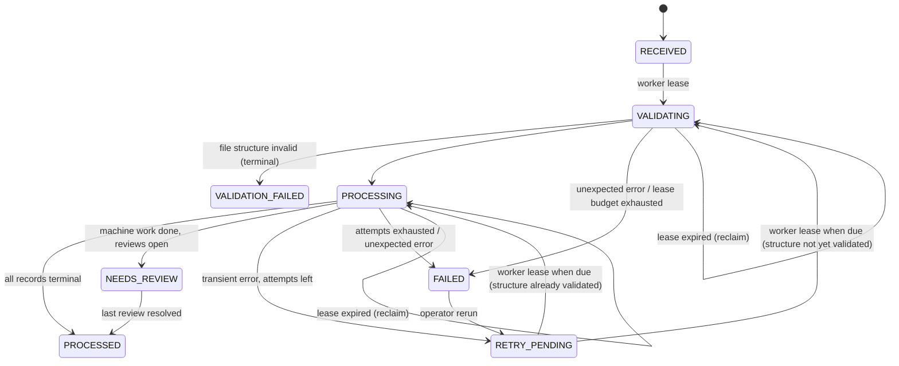
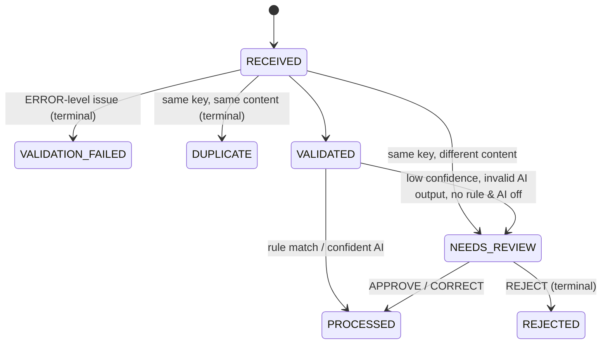

# OpsFlow — Data Model

All names, categories, vendors and rules here are invented for the fictional
company **Kestrel Freight Co.**

Conventions (`version` optimistic-lock columns exist only on `source_batch`,
`record` and `review_task` — the rows that are updated concurrently)

- IDs are UUIDs. Batch and record IDs are **deterministic UUIDv5** so a replay of
  the same input produces the same IDs (see ARCHITECTURE D2). IDs are never reused
  or reassigned.
- Money is `BIGINT` **minor units** (cents) and is always `> 0`; meaning comes from
  `direction` (`DEBIT` = money out, `CREDIT` = money in). Only `USD` in v1.
- Timestamps are `TIMESTAMPTZ`, UTC, supplied by an injected clock.
- `NULL` always means **"not determined yet"** — never "zero", "none" or "unknown".
  Explicit unknowns are explicit enum values.

## 1. Entity overview



## 2. Tables

### `source_batch` — one delivery (a file, a document, or one API pull window)

| Column | Type | Notes |
|---|---|---|
| `id` | uuid PK | uuid5(namespace, `source_type:content_sha256`) |
| `source_type` | text | `BANK_CSV` \| `INVOICE_DOC` \| `BOOKING_API` |
| `source_name` | text | file name or API window label (display only) |
| `business_date` | date NULL | from header/trailer; links to `expected_delivery` |
| `content_sha256` | char(64) | **UNIQUE (source_type, content_sha256)** → idempotent ingest |
| `status` | text | execution state, see §3.1 |
| `reconciliation_status` | text | `NOT_STARTED` \| `PENDING` \| `RECONCILED` \| `MISMATCH` \| `UNKNOWN` |
| `control_record_count` | int NULL | from trailer / API metadata; NULL = source provides none |
| `control_debit_minor` | bigint NULL | control total of debits |
| `control_credit_minor` | bigint NULL | control total of credits |
| `retry_budget_used` | int | automatic attempts since last operator rerun (history = `COUNT(processing_run)`) |
| `max_attempts` | int | default 3 |
| `next_attempt_at` | timestamptz NULL | set only while `RETRY_PENDING` |
| `lease_run_id` | uuid NULL | the `processing_run` currently holding the lease (unique per attempt, so a restarted worker can never mistake an old lease for its own) |
| `lease_expires_at` | timestamptz NULL | expired lease ⇒ batch is reclaimable |
| `structure_validated_at` | timestamptz NULL | checkpoint: file structure parsed and records registered; a retry resumes at `PROCESSING` instead of re-parsing |
| `received_at`, `updated_at` | timestamptz | |
| `version` | int | optimistic concurrency |

The raw delivered bytes are stored in `source_blob(batch_id PK, content bytea)` so a
batch can always be replayed from its original input.

### `record` — one logical input row (CSV line, invoice, booking)

| Column | Type | Notes |
|---|---|---|
| `id` | uuid PK | uuid5(namespace, `batch_id:line_no`) |
| `batch_id` | uuid FK | |
| `line_no` | int | **UNIQUE (batch_id, line_no)** |
| `raw_payload` | jsonb | exactly as parsed from the source; **never updated** |
| `content_fingerprint` | char(64) | sha256 of normalised business fields (dup detection) |
| `status` | text | record state, see §3.2 |
| `source_ref` | text NULL | natural key from the source (txn id, invoice no, booking id) |
| `business_date` | date NULL | |
| `counterparty` | text NULL | |
| `description` | text NULL | |
| `amount_minor` | bigint NULL | CHECK `amount_minor > 0` |
| `currency` | char(3) NULL | |
| `direction` | text NULL | `DEBIT` \| `CREDIT` |
| `category_code` | text NULL FK | final decision only |
| `category_source` | text NULL | `RULE` \| `AI` \| `HUMAN` — who made the final decision |
| `rule_id`, `rule_version` | text NULL | set iff `category_source = 'RULE'` |
| `decided_attempt_id` | uuid NULL FK | set iff `category_source = 'AI'` |
| `decided_review_id` | uuid NULL FK | set iff `category_source = 'HUMAN'` |
| `duplicate_of` | uuid NULL | set only when `status = DUPLICATE` |
| `version` | int | |

Invariants (DB CHECK constraints)

- `status = 'PROCESSED'` ⇒ `category_code`, `category_source`, `amount_minor`,
  `direction` are NOT NULL.
- `status = 'DUPLICATE'` ⇔ `duplicate_of IS NOT NULL`.
- Exactly the decision column matching `category_source` is set (R1 in the plan review).
- Normalised columns may be NULL only while `status IN ('RECEIVED','VALIDATION_FAILED')`.

### `record_claim` — atomic business-key ownership (dedupe across batches)

| Column | Type | Notes |
|---|---|---|
| `source_type`, `source_ref` | PK | |
| `record_id` | uuid FK | the canonical record that "owns" this business key |
| `content_fingerprint` | char(64) | to distinguish exact vs conflicting duplicates |

A claim is taken with `INSERT … ON CONFLICT DO NOTHING` after validation passes and is
**never released** — not even when the owner is `REJECTED`. An identical later copy
therefore inherits the rejection (`DUPLICATE`), and a changed copy goes to review as
`DUPLICATE_CONFLICT`. Releasing claims would make later outcomes depend on *when* a
reviewer decided, breaking deterministic replay.

### `validation_issue`

`id`, `record_id` (NULL for file-level issues), `batch_id`, `code`, `field`,
`message`, `severity` (`ERROR` blocks the record, `WARNING` does not).

### `classification_attempt` — evidence, kept separate from the final decision

| Column | Notes |
|---|---|
| `id`, `record_id`, `created_at` | |
| `method` | `RULE` \| `AI` |
| `rule_id`, `rule_version` | for `RULE` |
| `provider`, `model`, `prompt_version` | for `AI` |
| `input_fingerprint` | sha256 of the exact model input → AI cache key |
| `outcome` | `MATCHED` \| `NO_MATCH` \| `CONFLICT` (rule: two rules disagree — rule order never silently decides); `OK` \| `LOW_CONFIDENCE` \| `INVALID_RESPONSE` \| `PROVIDER_ERROR` (AI) |
| `category_code` | NULL unless the attempt produced one |
| `confidence` | numeric(4,3) NULL — **AI only**; rules never fake a confidence |
| `threshold` | numeric(4,3) NULL — threshold in force, for replayable decisions |
| `rationale` | text NULL — model-provided reasoning summary |
| `raw_response` | text NULL — verbatim provider output (for invalid-response forensics) |
| `latency_ms` | int NULL |

### `review_task`

| Column | Notes |
|---|---|
| `id`, `record_id`, `created_at` | **UNIQUE (record_id) WHERE status = 'OPEN'** |
| `reason` | `LOW_CONFIDENCE` \| `AI_INVALID_RESPONSE` \| `NO_RULE_AI_DISABLED` \| `RULE_CONFLICT` \| `DUPLICATE_CONFLICT` |
| `suggested_category` | NULL if nothing to suggest |
| `conflicting_record_id` | set only for `DUPLICATE_CONFLICT` |
| `status` | `OPEN` \| `RESOLVED` |
| `decision` | `APPROVE` \| `CORRECT` \| `REJECT` (NULL while OPEN) |
| `decided_category`, `decided_by`, `decided_at`, `note` | `note` mandatory for CORRECT/REJECT |

### `processing_run` — one attempt to process a batch

`id`, `batch_id`, `attempt_no`, `worker_id`, `started_at`, `finished_at`,
`outcome` (`RUNNING` \| `SUCCEEDED` \| `RETRY_SCHEDULED` \| `FAILED` \| `ABANDONED`),
`error_code`, `error_detail`. `ABANDONED` is set when a lease expired with the run
still `RUNNING` (the worker crashed — we do *not* know what happened, so we do not
call it failed or succeeded).

### `reconciliation_result` — append-only history

`id`, `batch_id`, `computed_at`, `status`, counts (`received`, `processed`,
`rejected`, `validation_failed`, `duplicate`, `pending`), money
(`processed_debit_minor`, `processed_credit_minor`, `source_debit_minor`,
`source_credit_minor`), `checks` jsonb (list of `{name, result, expected, actual}`
with result `PASS` \| `FAIL` \| `UNKNOWN` \| `NOT_APPLICABLE`).
`source_batch.reconciliation_status` is a denormalised copy of the latest row.

### `expected_delivery` — what *should* have arrived

`id`, `source_type`, `business_date`, `due_at`, `grace_minutes`,
UNIQUE (`source_type`, `business_date`). Arrival status is **derived at query
time** (never stored, so it cannot drift):

| Derived status | Condition |
|---|---|
| `ARRIVED` | a non-`VALIDATION_FAILED` batch exists with `received_at <= due_at` |
| `ARRIVED_LATE` | such a batch exists with `received_at > due_at` |
| `ARRIVED_INVALID` | only `VALIDATION_FAILED` batches exist (something came, nothing usable) |
| `AWAITING` | no batch, `now <= due_at` |
| `LATE` | no batch, `due_at < now <= due_at + grace` |
| `MISSING` | no batch, `now > due_at + grace` |

### `audit_event` — append-only (UPDATE/DELETE blocked by trigger)

`id` bigserial, `occurred_at`, `actor` (`system:<worker>` \| `user:<name>`),
`entity_type`, `entity_id`, `batch_id` (for one-query batch timelines), `action`,
`from_state`, `to_state`, `run_id` NULL,
`details` jsonb. Written in the same transaction as the change it describes.

### `category` — reference data

| code | label | direction |
|---|---|---|
| `FUEL` | Fuel & charging | DEBIT |
| `TOLLS_PARKING` | Tolls & parking | DEBIT |
| `VEHICLE_MAINTENANCE` | Vehicle maintenance & tyres | DEBIT |
| `SUBCONTRACT_HAULAGE` | Subcontracted haulage | DEBIT |
| `OFFICE_SOFTWARE` | Office & software | DEBIT |
| `BANK_FEES` | Bank & card fees | DEBIT |
| `FREIGHT_REVENUE` | Freight revenue | CREDIT |
| `STORAGE_REVENUE` | Warehousing revenue | CREDIT |

There is deliberately **no** "Other/Uncategorised" category: a record that cannot
be categorised is `NEEDS_REVIEW`, not quietly filed under "Other".

## 3. State machines

### 3.1 Batch execution status



`RECONCILED` is **not** an execution state: it is a value of
`reconciliation_status`. A batch can finish executing and still not balance; one
field cannot honestly carry both facts.

### 3.2 Record status



`VALIDATED` is a durable checkpoint: if the AI provider is down, records wait
there and the batch retries; nothing is re-validated or double counted.

## 4. Reconciliation definition

For a batch, from current record states:

```
received = processed + rejected + validation_failed + duplicate + pending
pending  = count(status IN ('RECEIVED','VALIDATED','NEEDS_REVIEW'))
```

| Check | PASS when | Otherwise |
|---|---|---|
| `identity` | the equation above holds | FAIL (a bug — should never happen) |
| `completeness` | `received == control_record_count` | FAIL; NOT_APPLICABLE if no control count |
| `source_debit_total` | Σ debits of all parseable records == `control_debit_minor` | FAIL; UNKNOWN if any amount/direction unparseable or records not yet normalised; NOT_APPLICABLE if no control |
| `source_credit_total` | same for credits | same |
| `no_pending` | `pending == 0` | UNKNOWN (final values not yet determined) |

Overall precedence: any FAIL ⇒ `MISMATCH`; else pending > 0 ⇒ `PENDING`; else any
UNKNOWN ⇒ `UNKNOWN`; else `RECONCILED`. A structurally invalid batch is `UNKNOWN`
(nothing trustworthy to reconcile). `RECONCILED` means *every received record and
every cent is accounted for* — records that failed validation are accounted for as
exclusions and reported separately; they are never hidden. `processed_*_minor` (what
flows to reporting)
excludes duplicates, rejected and failed records, so it is reported alongside —
never substituted for — the source totals.
